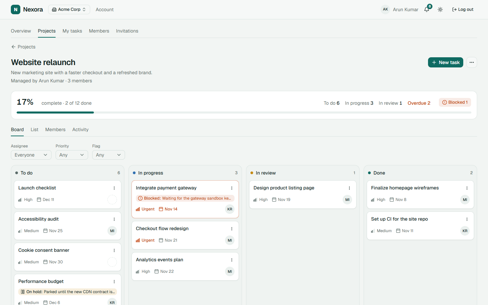
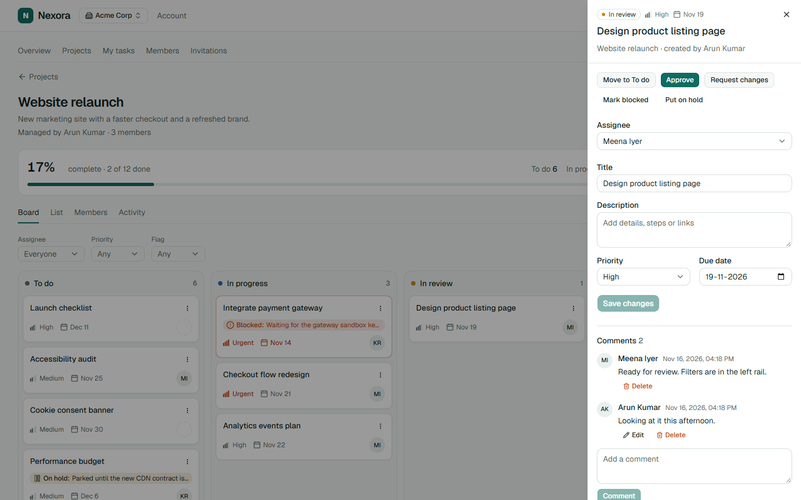
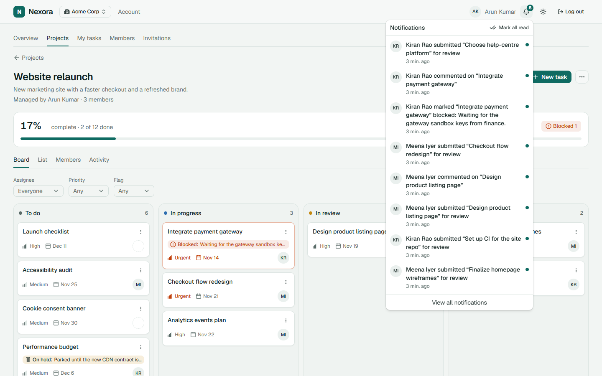
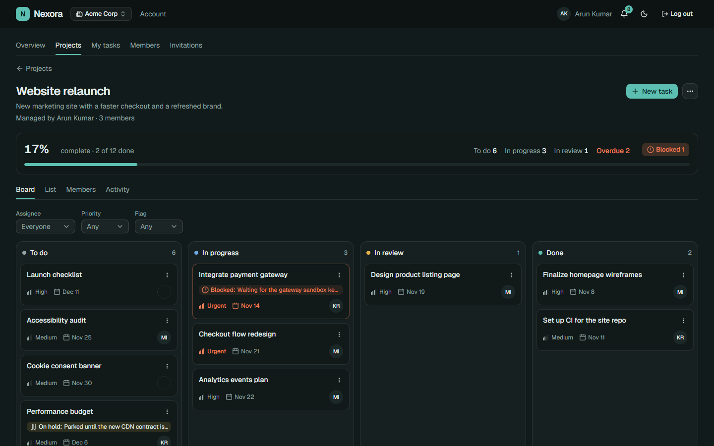
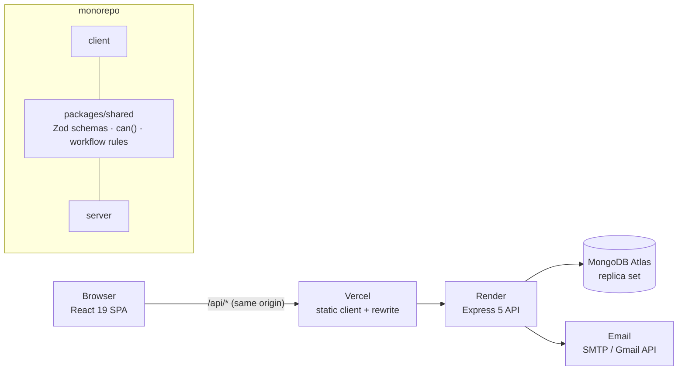

# Nexora

**Multi-tenant project management for growing teams.** Each organization gets its own workspace with roles, Kanban boards and a review step, so everyone knows what to work on next and nothing reaches "Done" without a second pair of eyes.

Built solo as a full-stack portfolio project: requirements, design docs, a TypeScript monorepo, about 440 automated tests, browser end-to-end tests in CI and a deployed MVP.

**Live:** https://nexora-six-rouge.vercel.app · **API docs:** `/api/docs` (Swagger UI, generated from the validation schemas)



| Task panel and review                          | Notifications                                        | Dark mode                                      |
| ---------------------------------------------- | ---------------------------------------------------- | ---------------------------------------------- |
|  |  |  |

## What it does

- **Organizations and approval.** Anyone can register an organization (one per account); the Application Owner approves, rejects, suspends or reactivates it. Every action is emailed and kept in a status history.
- **Roles.** Tenant Admin, Project Manager and Team Member, with permissions checked on every request. Invite people by email, singly or in bulk; the last admin can never be removed.
- **Projects and tasks.** Projects with a manager and members, tasks with priority, due dates (overdue computed in the organization's time zone), assignees, archive and restore.
- **Kanban with a review rule.** Drag cards with the mouse or keyboard, or use each card's "Move to" menu. Team Members submit work for review; only the project's manager or an admin approves it, or sends it back with a reason. Tasks can be marked Blocked or On hold with a reason, and blockers are listed for the manager.
- **Collaboration.** Comments, a full history on every task, a project activity feed and in-app notifications (unread badge, mark read or all).
- **The details.** Light and dark themes, responsive down to 360 px, avatars, password reset, email verification.

## Architecture



- **One rule set, two consumers.** `packages/shared` holds the Zod schemas, the permission function `can()` and the workflow rules. The API enforces them; the UI uses the same functions to hide actions and explain refused drops before sending anything.
- **Tenant isolation by construction.** Shared collections with `organizationId` on every document; a Mongoose plugin throws on any query without it. A test calls all 46 tenant endpoints from another organization and expects 404.
- **Consistency under concurrency.** Changes, their history and their notifications are written in one transaction. Tasks use optimistic concurrency (`version`, 409 on conflict). Invariants such as "one organization per user" and "at least one admin" are database indexes and atomic updates, each with a race test.
- **Auth.** A 15-minute JWT kept in memory, plus a rotating refresh token in an httpOnly cookie with reuse detection.

The eight key decisions, with trade-offs: [Architecture decisions](docs/phase-5/architecture-decisions.md). Security and performance results: [Review](docs/phase-5/security-and-performance-review.md).

## Tech stack

| Area     | Choices                                                                                                          |
| -------- | ---------------------------------------------------------------------------------------------------------------- |
| Client   | React 19, Vite, TypeScript, TanStack Query, Zustand, React Router, Tailwind CSS v4, shadcn/ui (Base UI), dnd-kit |
| Server   | Node.js 24, Express 5, Mongoose 9, Zod 4, JWT, bcrypt, sharp, Nodemailer / Gmail API, pino                       |
| Database | MongoDB Atlas (transactions, TTL and partial unique indexes)                                                     |
| Testing  | Vitest, Supertest, mongodb-memory-server, Playwright                                                             |
| Delivery | GitHub Actions (lint, typecheck, tests, build, e2e), Render (API), Vercel (client)                               |

## Run it locally

You need Node.js 24 and a MongoDB **replica set** (transactions need one; a free Atlas cluster works).

```bash
npm ci
cp server/.env.example server/.env        # set MONGODB_URI and JWT_ACCESS_SECRET
npm run db:sync-indexes
OWNER_EMAIL=owner@example.com OWNER_PASSWORD=Owner1234 npm run db:seed   # the Application Owner
npm run db:seed:demo                      # optional: Acme Corp with people, projects and tasks
npm run dev                               # client on :5173, API on :4000
```

On Windows PowerShell, set the variables first: `$env:OWNER_EMAIL="…"; $env:OWNER_PASSWORD="…"; npm run db:seed`.

With `EMAIL_TRANSPORT=console`, verification and invitation emails are printed in the API terminal.

**Demo logins** (after `db:seed:demo`, password `Demo1234`):

| Who             | Email                | Sees                                                     |
| --------------- | -------------------- | -------------------------------------------------------- |
| Tenant Admin    | `priya@acme.example` | everything in Acme Corp, members, invitations, settings  |
| Project Manager | `arun@acme.example`  | manages "Website relaunch": reviews, blockers, approvals |
| Team Member     | `meena@acme.example` | her tasks, the board, submitting work for review         |

## Tests

```bash
npm test          # unit and API tests (shared, server, client)
npm run e2e       # Playwright: three journeys against an in-memory database
```

The end-to-end journeys are: a visitor registers, verifies, registers an organization and the Owner approves it; a member submits work and the manager approves it from a notification; an invited person creates an account and joins. CI runs all of it on every pull request, and production deploys only after both jobs pass.

## Repository layout

```
client/            React app (features/: auth, organizations, members, projects, notifications, platform)
server/            Express API (modules/: auth, organizations, members, invitations, projects,
                   tasks, comments, activity, notifications, platform, users, docs)
packages/shared/   Zod schemas, permissions and workflow rules used by both
e2e/               Playwright journeys and the test stack
docs/              phase 0–5 documents, sprint notes, screenshots
```

## How it was built

The project followed a small but complete process, all written down in `docs/`:

1. **Discovery:** problem, audience, competitors, vision ([phase-1](docs/phase-1)).
2. **Requirements:** functional and non-functional requirements, roles, journeys, user stories ([phase-2](docs/phase-2)).
3. **Design:** architecture, data model, API, auth, tenancy, integrations, deployment, UI theme ([phase-3](docs/phase-3)).
4. **Delivery:** seven sprints, one pull request per epic, each with tests and a browser check ([plan](docs/phase-4/implementation-plan.md), [sprints](docs/sprints)).
